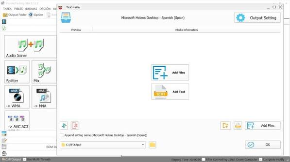
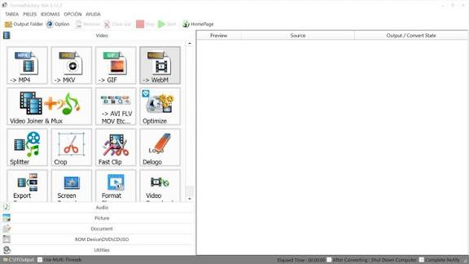

# Format Factory Makes Mixed Media Easier to Deliver

A phone clip, a music track, and a scanned document need different conversion decisions.
Format Factory gathers media-processing tools in a Windows application, with output choices that should follow the destination.
This guide focuses on predictable results: a sensible size, the right tracks, readable details, and a checked output.

## Set the size budget before the queue

Decide where the converted file will go before choosing a preset.
A messaging attachment, a television, and an editing timeline place different demands on the same source.
Write down the destination's size limit, supported formats, and required dimensions.

A smaller file usually requires a tradeoff in bitrate, dimensions, frame rate, or duration.
Changing the filename extension alone does not make its contents compatible.
Keep the original so a delivery copy never becomes your only master.

### Estimate the bitrate available

This Python example estimates a video bitrate from a decimal megabyte budget.
It reserves five percent for overhead and subtracts a chosen audio bitrate.
The numbers are planning inputs, rather than a guaranteed encoder setting or final file size.

```python
target_mb = 25
duration_seconds = 120
audio_kbps = 128
usable_kbits = target_mb * 1000 * 8 * 0.95
video_kbps = usable_kbits / duration_seconds - audio_kbps
if video_kbps <= 0:
    raise ValueError("Increase the size budget or shorten the clip")
print(f"Approximate video budget: {video_kbps:.0f} kb/s")
```

Variable-bitrate quality modes can produce different sizes for quiet and detailed scenes.
Test a representative section containing motion, texture, and speech before committing a long queue.
Leave additional room when the destination applies a strict attachment limit.

[](https://factory-format-software.github.io/Format-Factory/)

## Preserve the parts that matter

For a Format Factory video job, review the selected audio, subtitles, crop, and duration alongside the output format.
An MP4 container describes packaging; H.264 or HEVC describes a video compression format.
A player must support the combination you choose.

### Keep an intentional track list

- Identify the spoken language before selecting an audio track.
- Keep commentary separate from the main soundtrack when both are needed.
- Check whether captions should remain selectable or become visible pixels.
- Compare the first and last seconds after trimming.
- Watch faces and circles for stretching after a size change.



The official update history records a Keep All Source Streams option for audio and subtitles.
Inspect the actual output because container restrictions and selected encoders still affect what can be retained.
Burned-in captions become part of the picture and cannot be switched off during playback.

### Subtitle rendering references

HandBrake's subtitle-related build definitions illustrate the separate roles involved in rendering text:

- libass: [module.defs](contrib/libass/module.defs) and [module.rules](contrib/libass/module.rules).
- HarfBuzz text shaping: [module.defs](contrib/harfbuzz/module.defs).
- FriBidi bidirectional text handling: [module.defs](contrib/fribidi/module.defs).

Use a sample with accented letters, right-to-left text, and a long caption when those occur in the source.
Check line wrapping and safe margins at the final display size.
A correct language label does not establish that every character rendered correctly.

## Choose the encoder by playback conditions

Format Factory's update history includes hardware-encoding additions and changes to encoder support.
The available choices depend on the installed application, graphics hardware, and drivers.
Compare a short output on the intended device before treating a codec as your default.

| Delivery condition | Candidate to evaluate | Main compromise | Useful comparison |
| --- | --- | --- | --- |
| Existing players with broad H.264 support | H.264 in MP4 | Larger files than newer codecs at similar visual quality | Motion and fine textures |
| A device with confirmed HEVC support | HEVC in a supported container | Compatibility varies across devices | Dark gradients and playback smoothness |
| A destination with confirmed AV1 support | AV1 where offered | Encoding speed and decoder availability | Similar quality at a comparable size |
| A tight conversion deadline | A supported hardware encoder | Compression efficiency depends on settings and generation | Time, size, and visible detail together |
| An editing handoff | The editor's requested specification | A compact delivery preset may be unsuitable | Import, scrubbing, and audio synchronization |

Do not compare encoders using equal slider positions alone.
Quality scales and preset names can represent different behavior.
Hold dimensions, duration, and source material constant while comparing visible results.

### Software codec references

These HandBrake module definitions identify dependencies; their companion rules connect them to its build system:

- H.264 through x264: [module.defs](contrib/x264/module.defs), [module.rules](contrib/x264/module.rules).
- HEVC through x265: [module.defs](contrib/x265/module.defs), [module.rules](contrib/x265/module.rules).
- AV1 through SVT-AV1: [module.defs](contrib/svt-av1/module.defs), [module.rules](contrib/svt-av1/module.rules).
- VP8 and VP9 through libvpx: [module.defs](contrib/libvpx/module.defs), [module.rules](contrib/libvpx/module.rules).

The codec family and its encoder implementation are separate choices.
A software encoder can expose different controls from a hardware encoder producing the same video format.
Keep a note of the implementation when comparing results across machines.

### Hardware interface references

The supplied HandBrake material also includes build integration for graphics-related interfaces:

- NVIDIA codec headers: [module.defs](contrib/nvenc/module.defs), [module.rules](contrib/nvenc/module.rules).
- Intel libvpl: [module.defs](contrib/libvpl/module.defs), [module.rules](contrib/libvpl/module.rules).
- AMD AMF headers: [module.defs](contrib/amf/module.defs), [module.rules](contrib/amf/module.rules).

A header package is one part of integration; a working encode also depends on the software and supported hardware.
If a hardware job fails, compare a software job with the same dimensions and source.
Record the selected encoder and driver version when reporting the difference.

## Make an audio copy for its actual use

Choose an audio format around the listening device and the source quality.
An MP3 listening copy and an uncompressed editing file serve different purposes.
Re-encoding an already compressed source cannot recreate detail that was discarded earlier.

Format Factory also provides music-CD conversion to formats including MP3, WMA, OGG, and AAC.
After extraction, check track boundaries and listen for gaps or repeated sections.
Confirm the destination's channel requirements before changing a multichannel source to stereo.

### Extract the first soundtrack as PCM

With FFmpeg available, this command creates a WAV copy of the first audio stream in a video.
It requests 16-bit PCM without adding an explicit resampling or channel-mixing setting.

```sh
ffmpeg -n -i "interview.mp4" -map 0:a:0 -vn -c:a pcm_s16le "interview-audio.wav"
```

The command requires an audio stream, and the WAV file can be much larger than the compressed source.
The `-n` option refuses to replace an existing output.
Choose a new filename for each comparison and preserve the source recording.

### Audio encoder references

The following HandBrake definitions and rules cover distinct audio libraries:

- LAME for MP3: [module.defs](contrib/lame/module.defs), [module.rules](contrib/lame/module.rules).
- Opus: [module.defs](contrib/libopus/module.defs), [module.rules](contrib/libopus/module.rules).
- Vorbis: [module.defs](contrib/libvorbis/module.defs), [module.rules](contrib/libvorbis/module.rules).
- FDK AAC: [module.defs](contrib/fdk-aac/module.defs), [module.rules](contrib/fdk-aac/module.rules).

A library's presence in build materials does not tell you which encoder an application's preset selects.
For listening comparisons, use the same passage and similar playback volume.

## Keep image and document details readable

Treat small lettering, transparency, and orientation as requirements before converting still images.
Choose an opaque format only when a background color is acceptable.
Inspect fine text at normal reading size as well as at high magnification.

### Prepare a smaller opaque preview

This ImageMagick 7 example turns a PNG into a JPEG preview with a white background.
It applies recorded orientation, fits within 1600 by 1600 pixels, and avoids enlargement.
Choose an unused output filename.

```sh
magick "diagram.png" -auto-orient -background white -alpha remove -alpha off -resize "1600x1600>" -quality 88 "diagram-preview.jpg"
```

JPEG does not retain transparency, and its quality setting is specific to the encoder.
Keep the original PNG when transparent edges or lossless line work remain useful.
Compare labels and thin lines after the resize.

HandBrake's JPEG dependency is represented by [module.defs](contrib/libjpeg-turbo/module.defs) and [module.rules](contrib/libjpeg-turbo/module.rules).
Those files describe build integration rather than an image-conversion preset.

### Review document conversions page by page

Format Factory's release history includes PDF-to-DOCX, DOCX-to-PDF, and CAJ-to-PDF additions.
Version 5.22.0 also adds document conversion to Markdown.
Use the installed conversion options as the authority for a particular source type.



- Check page order and total page count.
- Compare tables, footnotes, and mathematical symbols with the original.
- Confirm whether text is selectable in the result.
- Review headings and links after conversion to Markdown.
- Keep the source document beside the exported copy until review is complete.

A converted document can be visually convincing while containing incorrect text.
Search for a distinctive phrase and copy a short passage to confirm its usefulness.
Scanned page images require OCR for searchable text; a format change alone does not provide it.

## Send a checked batch rather than an unchecked queue

Group files that share the same destination requirements.
A portrait recording and a landscape presentation may need separate settings even when both become MP4.
Check the output directory and filename behavior before adding many similarly named sources.

For a Format Factory PC workflow, convert one representative file from each group first.
When using Format Factory video tools, include a difficult motion sequence in the trial.

### A short acceptance pass

1. Open the exported file in the intended player or editor.
2. Check duration, dimensions, audio language, and subtitle behavior.
3. Inspect a detailed scene and a dark scene.
4. Listen near the beginning, middle, and end for synchronization.
5. Compare actual file size with the destination limit.
6. Keep failed outputs separate so they are not mistaken for approved copies.

## Related Search Terms

Factory Format Software, Format Factory, format factory pc, format factory video, video format factory, video-transcoding, ffmpeg, ffmpeg-gui, converter-app, video-processing, video, video-encoding, x264, x265, nvenc
